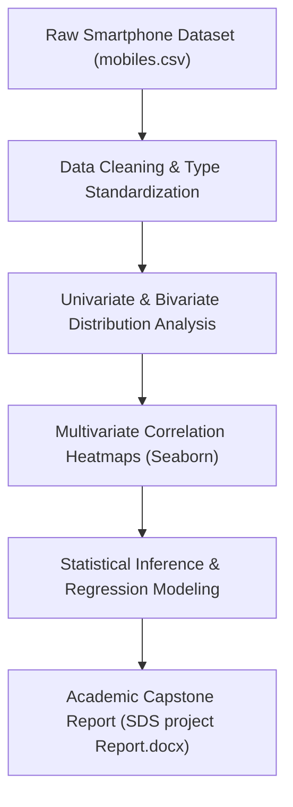

<p align="center">
  
</p>

<p align="center">
  
  
  
  
</p>

<a id="overview"></a>
## 📖 Executive Summary & Overview

Understanding consumer purchasing behaviors, pricing power, and technological trade-offs in dynamic technology markets requires rigorous statistical modeling. Simple descriptive metrics fail to capture nonlinear correlations between product specifications (battery mAh, processor clock, camera MP) and market price.

The **Statistical Data Science Semester 2 Project** (`SDS-Project-SEM-2`) delivers a comprehensive statistical study on mobile smartphone pricing dynamics. Documented across `SDS AMAR (2).ipynb` and `SDS project Report.docx`, the analysis implements data preprocessing, outlier elimination, multi-variable correlation matrices, and predictive regression models to quantify market drivers.

<a id="toc"></a>
## 📑 Table of Contents

- [📖 Executive Summary & Overview](#overview)
- [🎯 Key Features & Capabilities](#features)
- [🏗️ System Architecture & Pipeline](#architecture)
- [🛠️ Tech Stack Breakdown](#tech-stack)
- [⚙️ Reproducible Quickstart & Setup](#setup)
- [📁 Project Directory Layout](#project-layout)
- [👨‍💻 Author & Contributions](#author)

<a id="features"></a>
## 🎯 Key Features & Capabilities

- **Empirical Dataset Cleaning:** Cleaning irregular retail smartphone pricing records and normalizing hardware metrics.
- **Multivariate Visual EDA:** Seaborn pairplots, violin distributions, and heatmaps showing price sensitivity relative to RAM and internal storage.
- **Statistical Hypothesis Testing:** Analysis of variance (ANOVA) and correlation coefficient evaluations ($r$-values).
- **Comprehensive Academic Report:** Formal Word document detailing findings, methodologies, and retail recommendations.

<a id="architecture"></a>
## 🏗️ System Architecture & Pipeline



<a id="tech-stack"></a>
## 🛠️ Tech Stack Breakdown

| Technology | Category | Role |
| :--- | :--- | :--- |
| **Scientific Computing** | Python 3.8+ | Primary analytical runtime |
| **Data Munging** | Pandas | Dataframe transformations, group-by aggregations |
| **Statistical Diagnostics** | Seaborn & Matplotlib | Pair plots, box plots, and heatmaps |
| **Notebook Platform** | Jupyter Notebook | Interactive literate computational notebook |
| **Report Compilation** | Microsoft Word (`.docx`) | Academic submission and analysis writeup |

<a id="setup"></a>
## ⚙️ Reproducible Quickstart & Setup

### Prerequisites
- Python 3.8+ with virtual environment

```bash
# 1. Clone repository
git clone https://github.com/Amaraiah11/SDS-Project-SEM-2.git
cd SDS-Project-SEM-2

# 2. Setup virtual environment
python -m venv venv
venv\Scripts\activate   # Windows

# 3. Install dependencies
pip install pandas numpy matplotlib seaborn jupyter

# 4. Launch computational notebook
jupyter notebook "SDS AMAR (2).ipynb"
```

<a id="project-layout"></a>
## 📁 Project Directory Layout

```text
SDS-Project-SEM-2/
├── SDS AMAR (2).ipynb         # Computational Jupyter notebook with statistical analysis
├── SDS project Report.docx    # Formal academic statistical data science project report
└── README.md                  # Comprehensive project documentation
```

<a id="author"></a>
## 👨‍💻 Author & Contributions

This project is developed and maintained with high technical rigour by **Amaraiah C**, Software Engineer and Data Analytics Practitioner studying Bachelor of Computer Applications (BCA) at Alliance University.

- 🌐 **GitHub:** [@Amaraiah11](https://github.com/Amaraiah11)
- 💼 **LinkedIn:** [Connect on LinkedIn](https://www.linkedin.com/in/amaraiah-c/)
- 📧 **Institutional Contact:** `camaraiahBCA24@ced.alliance.edu.in`

### 🤝 Contribution Guidelines
Contributions, bug reports, and architectural discussions are welcome!
1. **Fork** the repository: `https://github.com/Amaraiah11/SDS-Project-SEM-2`
2. **Branch**: `git checkout -b feature/your-feature-name`
3. **Commit**: `git commit -m "feat: enhance feature logic"`
4. **Push**: `git push origin feature/your-feature-name`
5. **Open Pull Request** against the `main` branch.

---

<p align="center">
  <b>⭐ If this codebase or documentation assisted your engineering workflows, please star the repository! ⭐</b>
</p>

<p align="center">
  
</p>
