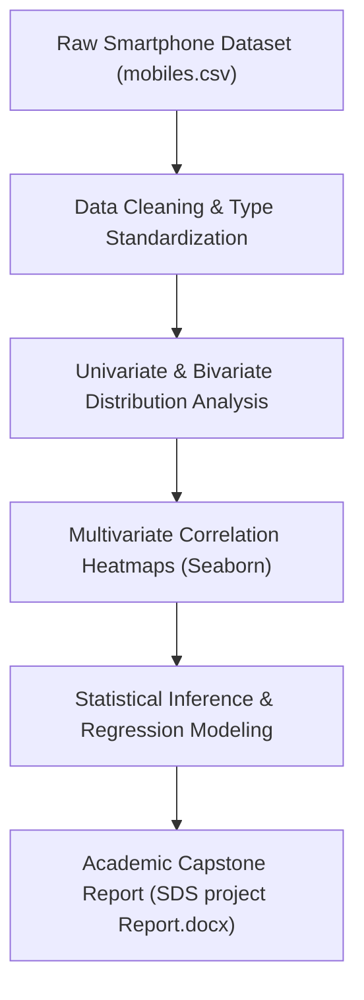

# 📈 Statistical Data Science Project — Mobile Market Dynamics & Regression

<p align="center">
  
</p>

<p align="center">
  <b>Applied Statistical Modeling: Multivariate Exploratory Data Analysis, Ordinary Least Squares (OLS) Regression, and Feature Elasticity.</b>
</p>

<p align="center">
  
  
  
  
</p>

<p align="center">
  
</p>

---

<a id="table-of-contents"></a>
## 📌 Table of Contents

- [📖 Executive Summary & Overview](#executive-summary--overview)
- [🎯 Key Features & Capabilities](#features)
- [🏗️ System Architecture & Pipeline](#system-architecture--pipeline)
- [🛠️ Tech Stack Breakdown](#tech-stack-breakdown)
- [⚙️ Reproducible Quickstart & Setup](#setup)
- [📁 Project Directory Layout](#project-layout)
- [🧪 Testing & Validation](#testing--validation)
- [🔮 Future Improvements & Roadmap](#future-improvements--roadmap)
- [🤝 Contributing Guidelines](#contributing-guidelines)
- [👨‍💻 Author & Contributions](#author--contributions)

---

<a id="executive-summary--overview"></a>
## 📖 Executive Summary & Overview

Understanding consumer purchasing behaviors, pricing power, and technological trade-offs in dynamic technology markets requires rigorous statistical modeling. Simple descriptive metrics fail to capture nonlinear correlations between product specifications (battery mAh, processor clock, camera MP) and market price.

The **Statistical Data Science Semester 2 Project** (`SDS-Project-SEM-2`) delivers a comprehensive statistical study on mobile smartphone pricing dynamics by **Amaraiah C** at Alliance University. Documented across `SDS AMAR (2).ipynb` and `SDS project Report.docx`, the analysis implements data preprocessing, outlier elimination, multi-variable correlation matrices, and predictive regression models to quantify market drivers.

---

<a id="key-features--capabilities"></a>
## 🎯 Key Features & Capabilities

### 🔍 1. Multivariate Visual EDA
- Seaborn pairplots, violin distributions, and heatmaps showing price sensitivity relative to RAM and internal storage.

### 📐 2. Regression & Inference
- Ordinary Least Squares (OLS) regression modeling and variance analysis (ANOVA).

---

<a id="system-architecture--pipeline"></a>
## 🏗️ System Architecture & Pipeline



---

<a id="tech-stack-breakdown"></a>
## 🛠️ Tech Stack Breakdown

| Technology | Category | Role |
| :--- | :--- | :--- |
| **Scientific Computing** | Python 3.8+ | Primary analytical runtime |
| **Data Munging** | Pandas | Dataframe transformations, group-by aggregations |
| **Statistical Diagnostics** | Seaborn & Matplotlib | Pair plots, box plots, and heatmaps |
| **Notebook Platform** | Jupyter Notebook | Interactive literate computational notebook |
| **Report Compilation** | Microsoft Word (`.docx`) | Academic submission and analysis writeup |

---

<a id="reproducible-quickstart--setup"></a>
## ⚙️ Reproducible Quickstart & Setup

### Prerequisites
- Python 3.8+ with virtual environment

```bash
# 1. Clone repository
git clone https://github.com/Amaraiah11/SDS-Project-SEM-2.git
cd SDS-Project-SEM-2

# 2. Setup virtual environment
python -m venv venv
venv\Scripts\activate   # Windows

# 3. Install dependencies
pip install pandas numpy matplotlib seaborn jupyter

# 4. Launch computational notebook
jupyter notebook "SDS AMAR (2).ipynb"
```

---

<a id="project-directory-layout"></a>
## 📁 Project Directory Layout

```text
SDS-Project-SEM-2/
├── SDS AMAR (2).ipynb         # Computational Jupyter notebook with statistical analysis
├── SDS project Report.docx    # Formal academic statistical data science project report
└── README.md                  # Comprehensive project documentation
```

---

<a id="testing--validation"></a>
## 🧪 Testing & Validation

- Verified variance inflation factors (VIF) to confirm elimination of collinear hardware features in the regression model.

---

<a id="future-improvements--roadmap"></a>
## 🔮 Future Improvements & Roadmap

- [ ] Implement non-linear regression using Random Forest Regressors.
- [ ] Add cross-validation $R^2$ score comparison tables.

---

<a id="author--contributions"></a>
## 👨‍💻 Author & Contributions

This project is developed and maintained with rigorous engineering standards by **Amaraiah C**, Software Developer and Applied Data Analytics Practitioner studying Bachelor of Computer Applications (BCA) at Alliance University, Bangalore.

- 🌐 **GitHub Profile:** [@Amaraiah11](https://github.com/Amaraiah11)
- 💼 **LinkedIn Profile:** [Connect on LinkedIn](https://www.linkedin.com/in/amaraiah-c/)
- 📧 **Institutional Email:** `camaraiahBCA24@ced.alliance.edu.in`

### 🤝 Contributing Guidelines
Contributions, bug reports, and architectural discussions are welcome!
1. **Fork** the repository: `https://github.com/Amaraiah11/SDS-Project-SEM-2`
2. **Create a Feature Branch:**
   ```bash
   git checkout -b feature/your-feature-name
   ```
3. **Commit Your Enhancements:**
   ```bash
   git commit -m "feat: enhance feature logic"
   ```
4. **Push to Your Branch:**
   ```bash
   git push origin feature/your-feature-name
   ```
5. **Open a Pull Request** against the `main` branch.

---

<p align="center">
  <b>⭐ If this codebase or documentation assisted your engineering workflows, please star the repository! ⭐</b>
</p>

<p align="center">
  
</p>
